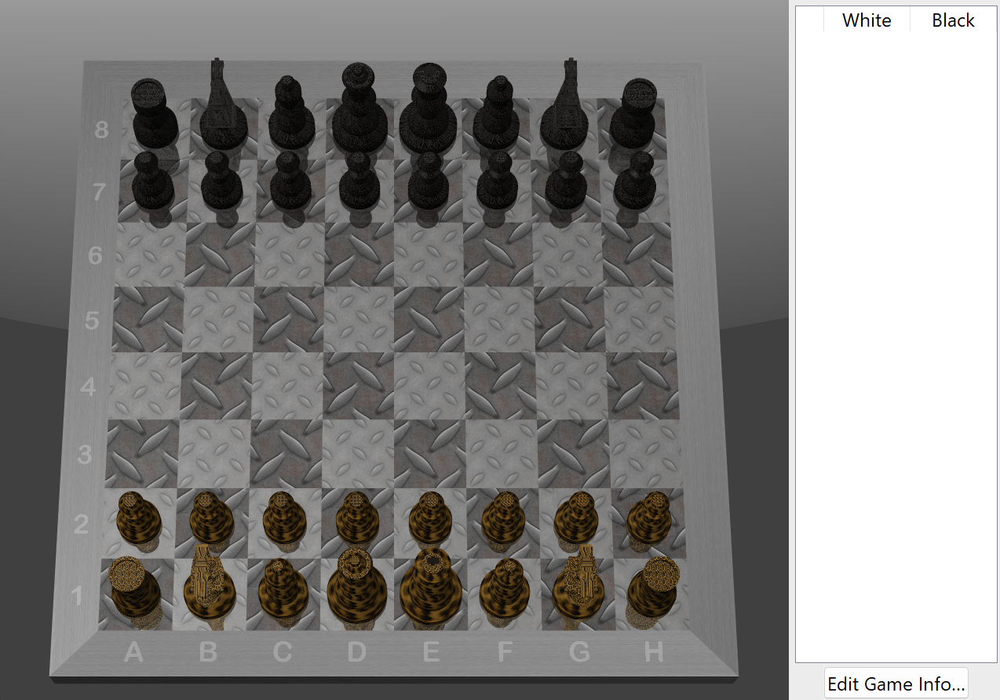

# Mchess: Apple's macOS Chess on Windows

Mchess is a Windows port of **Chess.app 3.18**, the chess game that ships with macOS. It recreates the Mac version's 3D board, lighting, reflections, pieces, menus, spoken moves and voice commands. It plays with **Sjeng 11.2**, the same engine the Mac version uses, compiled here for Windows.



## Download and run

Download **Chess.exe** from the [latest release](../../releases/latest) and double-click it. It is a single file, so there is nothing to install and Python isn't needed.

Windows may show a SmartScreen warning because the exe isn't signed. Click **More info → Run anyway**.

## How it was ported

The port was made by studying Apple's Chess.app binary in IDA Pro, together with Apple's published Chess source ([apple-oss-distributions/Chess](https://github.com/apple-oss-distributions/Chess)). Where it could, it copies the original's behaviour exactly:

- **The 3D board:** the same camera, lighting (a directional light, plus a spotlight on the picked square), reflections on the board, the frame with its coordinate labels, and the same piece shapes and textures. The board styles are Wood, Marble, Metal and Grass; the piece styles are Wood, Marble, Metal and Fur. All of these are Apple's own textures.
- **Move animation:** pieces slide to their new square over one second, and a captured piece fades out as the attacker arrives, as on the Mac.
- **Engine:** Apple's own copy of Sjeng with the opening books rebuilt from Apple's game collections. The search depths for each difficulty level are the original's. The app talks to Sjeng with the same commands Chess.app uses.
- **Game variants:** Regular, Crazyhouse, Suicide and Losers.
- **Speech:** moves are spoken in the original's wording, such as "Knight g1 to f3" or "check!", using the Windows voices. Moves can also be spoken to the game.
- **Files:** saved games use the original `.game` format and can also be saved as PGN.

The rest of the window is built with Tk, so the menus and dialogs look like Windows rather than macOS.

## Controls

### Moving pieces

| Action | How |
|---|---|
| Move a piece | Click the piece, then click the square. Or drag the piece to the square. |
| Type a move | Type the from-square, then the to-square, for example `e2` then `e4`. |
| Cancel a selection | Click the piece again, or press **Enter** or **Backspace**. |
| Choose the promotion piece | Click the spare piece beside the board to cycle Queen → Knight → Rook → Bishop, or type `=q`, `=n`, `=r` or `=b`. |
| Drop a piece (Crazyhouse) | Click or drag a captured piece from beside the board onto an empty square. |

### Moving the camera

Press the mouse on the **frame** around the board (the border with the letters and numbers, not the squares), hold the button, and move the mouse away from where you pressed.

- **Left or right** keeps the board spinning. The farther you move, the faster it spins.
- **Up or down** tilts the view, from a low angle up to nearly overhead.

The cursor hides while you hold the button. The view briefly settles when a side of the board faces you squarely. Release the button to stop. This works like the Mac version.

### Keyboard shortcuts

| Shortcut | Action |
|---|---|
| Ctrl+N | New game: choose players, variant and difficulty |
| Ctrl+O / Ctrl+S / Ctrl+Shift+S | Open, Save, Save As |
| Ctrl+Z | Take back a move |
| Ctrl+] | Show a hint (red arrow) |
| Ctrl+[ | Show the last move (blue arrow) |
| Ctrl+L | Show or hide the game log |
| Ctrl+, | Preferences: board and piece styles, voices, difficulty |
| F11 | Full screen |
| Ctrl+Q | Quit |

### Voice commands

Turn on **Allow Player to Speak Moves** in Preferences, then say:

- "Knight g1 to f3" or "Pawn e4 takes d5"
- "Castle kingside" or "Castle queenside"
- "Drop knight at c7" (Crazyhouse only)
- "Take back move"

## Difficulty

The slider in **New Game** and **Preferences** goes from 1 (faster) to 12 (stronger), as on the Mac. Each level sets how many moves ahead Sjeng searches.

- Levels 1–8 answer almost at once.
- Level 10 takes about a second.
- Level 12 takes up to about six seconds.

The computer always waits at least two seconds after your move before replying, as the Mac version does.

Apple's copy of Sjeng contains a bug: it ignores the search-depth command, so on the Mac every difficulty level probably plays at the same depth. This port fixes that one line so the levels work as intended. See [`sjeng_src/README.txt`](sjeng_src/README.txt).

## Running and building from source

You need Windows, Python 3 (tested with 3.14) and Pillow:

```
pip install pillow
python chess_app.py        (or run.bat)
```

To build the single-file exe:

```
pip install pyinstaller
python -m PyInstaller --noconfirm --clean Chess.spec
```

The exe is written to `dist\Chess.exe`.

`engine\sjeng.exe` is already included. To rebuild it, install the Visual Studio Build Tools and run `sjeng_src\build.bat`.

To check the chess rules, run `python test_rules.py`.

### Source files

| File | Purpose |
|---|---|
| `chess_app.py` | Window, menus, dialogs, input, speech and game flow |
| `board_gl.py` | The OpenGL board, pieces, lighting and camera |
| `chess_rules.py` | Move generation and the rules for all four variants |
| `sjeng_engine.py`, `chess_engine.py` | Connection to Sjeng, plus a small Python engine used as a fallback |
| `pgn_io.py` | Move notation, spoken moves, and `.game` and PGN files |
| `speech_win.py` | Windows speech output and voice recognition |
| `piece_meshes.json`, `Resources/` | Piece shapes, and Apple's board and piece textures |
| `engine/`, `sjeng_src/` | The Sjeng exe, its opening books, and its modified source |

## Credits and licences

- **Chess.app** and its textures (`Resources/`) are by Apple Inc., distributed under Apple's terms in [`Resources/APPLE_LICENSE.txt`](Resources/APPLE_LICENSE.txt). This project isn't affiliated with or endorsed by Apple.
- **Sjeng** is by Gian-Carlo Pascutto and contributors, under the GNU GPL version 2 or later. See [`sjeng_src/`](sjeng_src) and [`engine/COPYING.txt`](engine/COPYING.txt).
- **The port** is licensed under the GNU GPL v3. See [`LICENSE`](LICENSE).
